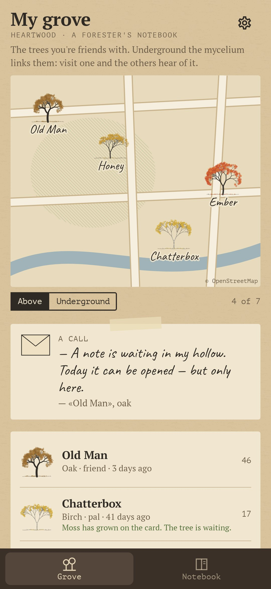
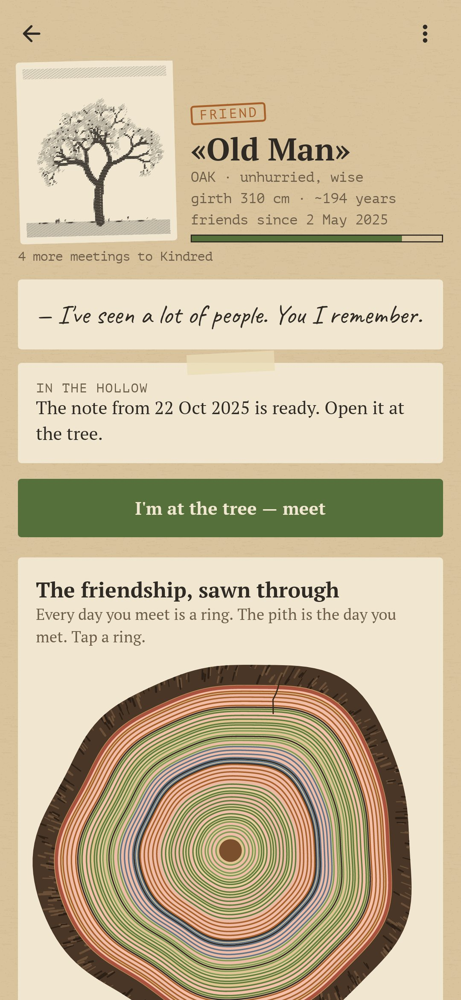
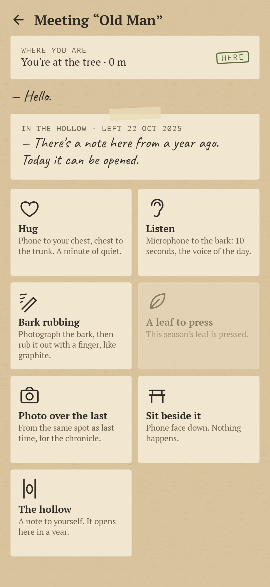
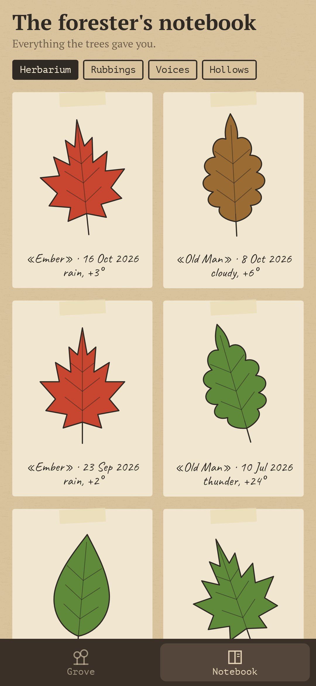
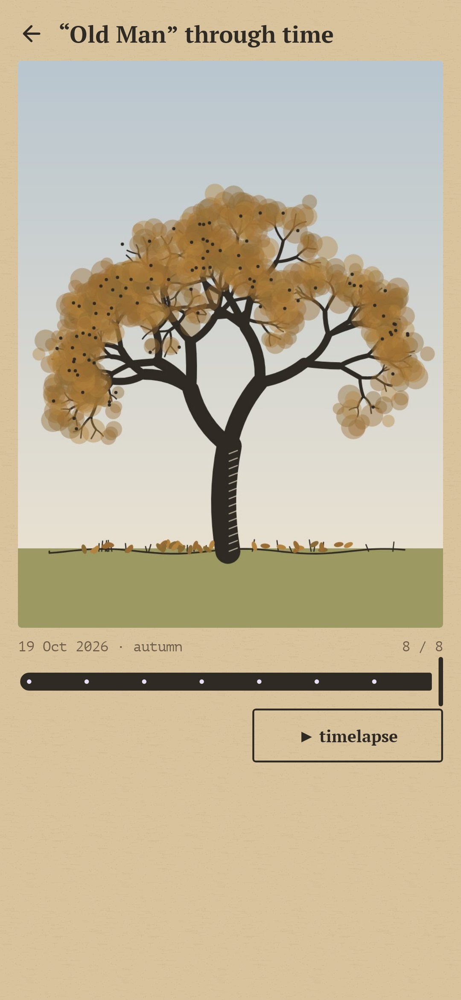

<div align="center">


# Heartwood

### Befriend a real tree. Every meeting is a ring.

*Pick a real tree — by your house, your school, in the park. Photograph it, work out what it is, hug it and mark it on the map. Then keep coming back: the friendship grows only from meetings at the tree itself, and over a year they build up into a sawn cross-section of rings. Free, no ads, no account.*

[](https://github.com/bigdevwhale/heartwood/actions/workflows/android.yml)
[](https://github.com/bigdevwhale/heartwood/releases/latest)


[](LICENSE)

**English** · [Русский](README.ru.md) · [Changelog](CHANGELOG.md)

    

</div>

---

## The idea

A tree is the most patient friend there is: it stays exactly where you left it, for a hundred years. Heartwood makes a friendship out of that. Nothing in the app moves the friendship forward except walking up to the tree; and what you get back is a record of the time you spent together, the way a tree keeps its own — in rings.

## How it works

1. **Meeting a tree.** Photograph it whole: the photo becomes an ink engraving, its portrait. Work out the species with an illustrated key (leaf, bark, needles), like an old field guide — twelve species, from oak and birch to rowan and poplar. Hug the trunk: did your hands meet? Otherwise give the girth, and the forester's rule (diameter × the species' growth factor) tells you roughly how old it is — "about 190 years: seven generations of people". Name it, write one line on why this one, and set its point on the map.
2. **The cross-section.** Every day you meet is a ring; the pith is the first meeting. A ring is drawn in the season's colour, a hug warms the wood, a long absence leaves a dark line, like a dry year. Tap a ring and the tree remembers that day in its own voice: "It was snowing. One line of footprints led to my trunk."
3. **Only at the tree.** Everything happens within 50 metres of its point (GPS):
   - **Hug** — the phone screen-in against your chest, your chest against the trunk. While the proximity sensor is covered and the phone is still, a heartbeat plays in your hand and slows from yours toward the tree's. A minute of it is a hug.
   - **Listen** — the microphone against the bark for ten seconds: the voice of the day, to play back in winter.
   - **Bark rubbing** — photograph the bark, then rub it out of blank paper with a finger, like graphite. The relief comes from the real ridges of this tree.
   - **A leaf to press** — one fallen leaf a season goes into the herbarium.
   - **A photo over the last** — fit each new photo over a ghost of the previous one, and the chronicle becomes a timelapse of the tree through the years.
   - **Sit beside it** — the phone face down; a clock that only runs while it lies still. Nothing else happens.
   - **The hollow** — a note to yourself that opens a year later, only at this tree.
4. **Friendship.** Stranger, acquaintance, pal, friend, kindred: by meetings, by seasons met in, and kindred only after a full year.
5. **The grove.** Up to seven trees on an old-survey-style map. Switch to *underground* and the mycelium shows between them, with news running along the threads from the friend you met last — "“Old Man” passes on through the roots: the jays are hiding his acorns again."
6. **Calls, rarely.** A tree calls when it has a reason: the linden is in blossom, the maple is all red, the first snow, a year since you met, a note ripe in the hollow. Twice a month at most, never at night.
7. **No guilt.** A tree doesn't wilt if you vanish. Moss grows on its card, and when you come back it says "I knew you'd come."
8. **Pass a tree on.** A QR code a friend reads with their phone camera: the tree becomes theirs too, with their own rings.

## Privacy

No ads, no accounts, no analytics. Everything stays on the phone. The only network requests are OpenStreetMap tiles and the current weather at the tree's rounded coordinates (Open-Meteo, falling back to MET Norway) — so a ring can remember the rain. Photos are taken with the phone's own camera app; the app has no camera permission.

## Build

```sh
./gradlew assembleDebug                      # app.heartwood.dev
./gradlew assembleDebug -Pdemo               # app.heartwood.demo: a lived-in grove in Prague
./gradlew testDebugUnitTest                  # rules: rings, friendship, calls, gifts
./gradlew testDebugUnitTest -Prender         # screen renders + species sheet to app/build/art
python tools/shots.py                        # renders → docs/screenshots
```

Kotlin, Jetpack Compose, Room, osmdroid. Every tree, leaf, bark rubbing and cross-section is drawn in code.

## License

[MIT](LICENSE). Map data © OpenStreetMap contributors. Part of [Stillcraft](https://bigdevwhale.github.io/stillcraft/).
