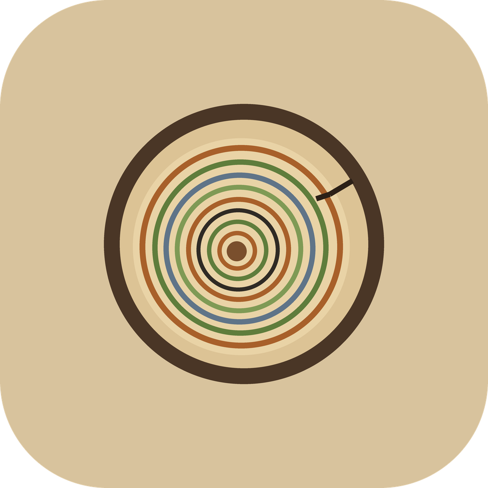
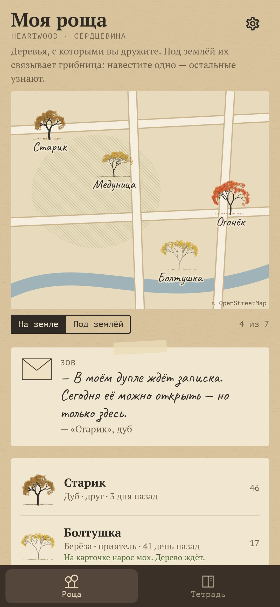
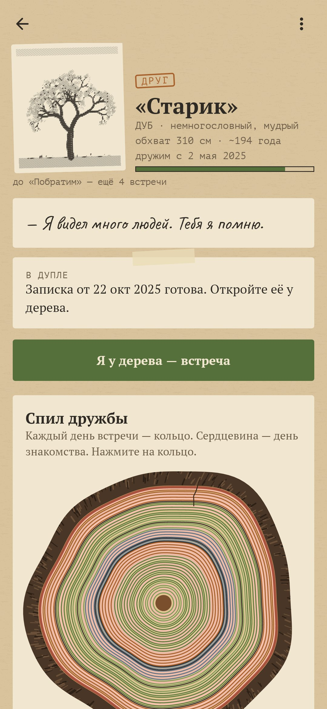
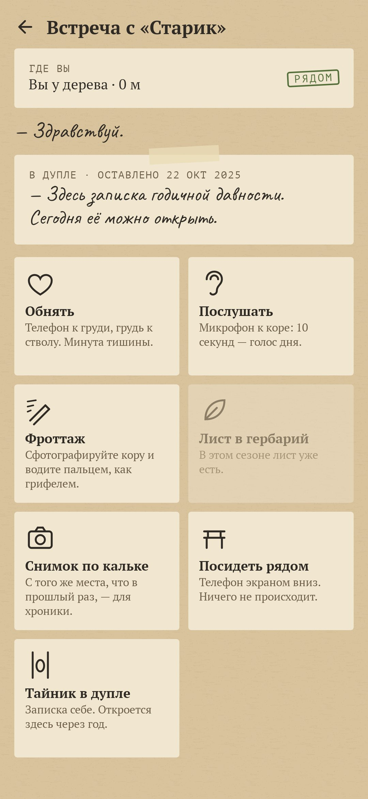
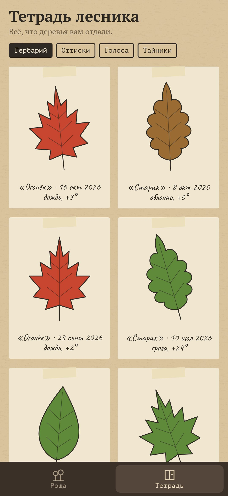
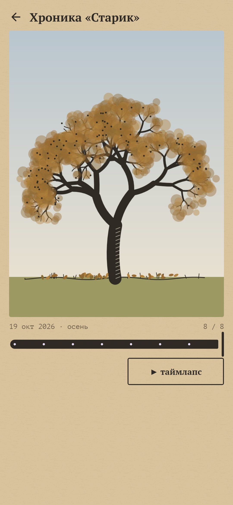

# Сердцевина (Heartwood)

### Подружитесь с настоящим деревом. Каждая встреча — кольцо.

*Выберите настоящее дерево — у дома, у школы, в парке. Сфотографируйте его, определите породу, обнимите и отметьте на карте. А потом приходите: дружба растёт только от встреч у самого дерева, и за год они складываются в спил с годовыми кольцами. Бесплатно, без рекламы и аккаунтов.*

[English](README.md) · **Русский** · [Изменения](CHANGELOG.md)

    

---

## Идея

Дерево — самый терпеливый друг: оно стоит ровно там, где вы его оставили, сто лет. «Сердцевина» превращает это в дружбу. Ничто в приложении не двигает её вперёд, кроме дороги к дереву, а взамен остаётся запись проведённого вместе времени — так, как дерево хранит своё: кольцами.

## Как это устроено

1. **Знакомство.** Фото дерева целиком превращается в гравюру тушью — его портрет. Порода определяется по иллюстрированному ключу (лист, кора, хвоя), как в старом определителе: двенадцать пород, от дуба и берёзы до рябины и тополя. Обнимите ствол: руки сомкнулись? Если нет — укажите обхват, и формула лесоводов (диаметр × коэффициент породы) назовёт примерный возраст: «около 190 лет — это семь поколений людей». Имя, одна строка «почему именно оно» и точка на карте.
2. **Спил дружбы.** Каждый день встречи — кольцо, сердцевина — день знакомства. Кольцо окрашено в цвет сезона, объятие делает древесину тёплой, долгая разлука оставляет тёмную черту, как засушливый год. Нажмите на кольцо — дерево вспомнит тот день своими словами: «Шёл снег. К стволу вела одна цепочка следов».
3. **Только рядом.** Всё происходит в пределах 50 метров от дерева (GPS):
   - **Обнять** — телефон экраном к груди, грудь к стволу. Пока датчик приближения закрыт и телефон неподвижен, в ладони бьётся сердце и замедляется к ритму дерева. Минута — объятие.
   - **Послушать** — микрофон к коре на десять секунд: голос дня, чтобы послушать зимой.
   - **Фроттаж** — сфотографируйте кору и проявите её пальцем на чистой бумаге, как грифелем. Рельеф берётся из настоящих бороздок этого дерева.
   - **Лист в гербарий** — один упавший лист в сезон.
   - **Снимок по кальке** — каждый новый снимок совмещается с прозрачной калькой прошлого, и хроника становится таймлапсом дерева сквозь годы.
   - **Посидеть рядом** — телефон экраном вниз; часы идут, только пока он лежит неподвижно. Больше ничего не происходит.
   - **Тайник в дупле** — записка себе, которая откроется через год и только у этого дерева.
4. **Дружба.** Незнакомец, знакомый, приятель, друг, побратим — по числу встреч, по временам года и, для побратима, после целого года.
5. **Роща.** До семи деревьев на карте в духе старой топосъёмки. Режим «под землёй» показывает грибницу между ними, и по нитям бегут весточки от того, кого вы навестили последним: «"Старик" передаёт по грибнице: сойки опять прячут его жёлуди».
6. **Зов — изредка.** Дерево зовёт, только когда есть повод: липа зацвела, клён весь красный, первый снег, год знакомства, созрела записка в дупле. Не чаще двух раз в месяц и никогда ночью.
7. **Без укоров.** Если пропасть, дерево не засохнет: на карточке просто нарастёт мох, а при встрече оно скажет «Я знал, что придёшь».
8. **Передать дерево.** QR-код, который друг считывает обычной камерой телефона: дерево становится и его, с его собственными кольцами.

## Приватность

Без рекламы, аккаунтов и аналитики. Всё хранится на телефоне. В сеть уходят только запросы тайлов OpenStreetMap и текущей погоды по округлённым координатам дерева (Open-Meteo, запасной — MET Norway), чтобы кольцо запомнило дождь. Фото снимает системная камера; разрешения на камеру у приложения нет.

## Лицензия

[MIT](LICENSE). Данные карты © участники OpenStreetMap. Часть [Stillcraft](https://bigdevwhale.github.io/stillcraft/).
